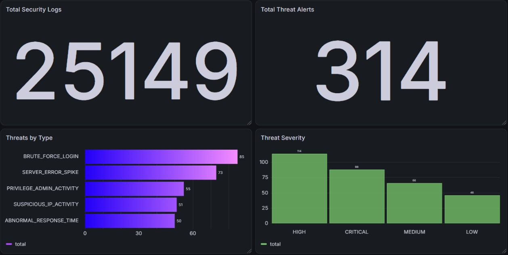
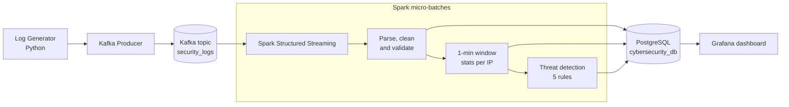
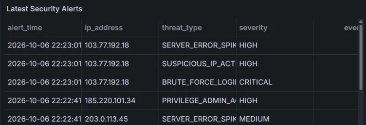
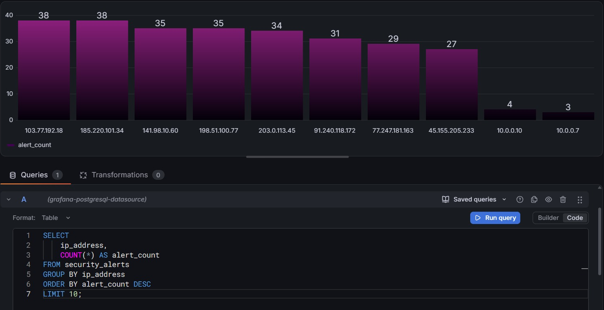

# Real-Time Cybersecurity Log Analytics Pipeline

An end-to-end, distributed streaming pipeline that ingests security logs through **Apache Kafka**, processes them with **Apache Spark Structured Streaming**, detects threats with rule-based analytics, stores the results in **PostgreSQL** and shows them on a live **Grafana** dashboard.

> Practical project for the course **Distributed Data Processing**, SIES Graduate School of Technology, Department of Artificial Intelligence & Data Science (TE AI-DS, Div G, 2026).




## Contents
- [Overview](#overview)
- [Architecture](#architecture)
- [Tech stack](#tech-stack)
- [Threat detection rules](#threat-detection-rules)
- [Results](#results)
- [Project structure](#project-structure)
- [Getting started](#prerequisites-windows-1011)
- [Troubleshooting](#troubleshooting-windows)
- [Team](#team)

## Overview
Servers and applications produce a continuous stream of security events. Attacks such as brute-force logins, scanning, or abuse of admin accounts are hidden among thousands of normal events and must be detected within seconds.

This project simulates that environment and processes it end to end:

- **Log generation**: a Python generator produces ~10 normal events per second plus random attack bursts (brute force, high volume, error spikes, admin abuse, slow responses) from 8 attacker IPs. About 1% of records are deliberately malformed.
- **Streaming ingestion**: events are published to the Kafka topic `security_logs` (3 partitions, keyed by IP address).
- **Stream processing**: Spark Structured Streaming parses, cleans and validates each micro-batch, then aggregates events per IP in 1-minute windows with a 2-minute watermark.
- **Threat detection**: five rules turn window statistics into alerts with a severity level and a readable description.
- **Storage**: logs, window statistics and alerts are upserted into PostgreSQL with `INSERT ... ON CONFLICT`, so reprocessing never creates duplicates.
- **Visualisation**: a Grafana dashboard reads PostgreSQL and refreshes automatically.

## Architecture


Two streaming queries run in parallel: raw logs are appended every 5 seconds, and window statistics plus alerts are written in update mode every 10 seconds. Both are checkpointed, and database writes are retried 3 times before the batch fails and Spark replays it from its checkpoint.

## Tech stack
| Layer | Technology |
|---|---|
| Event generation | Python 3.11 |
| Messaging | Apache Kafka 4.x (KRaft mode), `confluent-kafka` client |
| Stream processing | Apache Spark 3.5.1 Structured Streaming (PySpark, `local[*]`) |
| Storage | PostgreSQL 14+, `psycopg2` |
| Visualisation | Grafana OSS 10+ (PostgreSQL data source) |
| Configuration | `python-dotenv` (`.env`) |

## Threat detection rules
All rules are evaluated per IP address in a 1-minute window. Thresholds can be changed in `spark/threat_detection.py`.

| Threat type | Rule | Severity |
|---|---|---|
| BRUTE_FORCE_LOGIN | ≥5 failed LOGIN/SSH_LOGIN | HIGH, CRITICAL ≥10 |
| SUSPICIOUS_IP_ACTIVITY | ≥60 requests | MEDIUM, HIGH ≥100 |
| SERVER_ERROR_SPIKE | ≥15 responses with code ≥400 | MEDIUM, HIGH ≥30 |
| PRIVILEGE_ADMIN_ACTIVITY | ≥5 events by `admin`/`root` or on `/admin`, `/api/admin`, `/etc/passwd`, `/.env` | HIGH, CRITICAL ≥8 |
| ABNORMAL_RESPONSE_TIME | avg response ≥2000 ms (≥3 requests) | LOW/MEDIUM/HIGH (≥3500/≥5000) |

Reliability: invalid/malformed records are dropped in Spark (~1% are deliberately corrupt); writes use `INSERT ... ON CONFLICT` (duplicates ignored, window updates upserted); DB writes retry 3× and then fail the batch so Spark replays it from its checkpoint.

## Results
In a sample run the pipeline processed **25,149 security logs** and raised **314 threat alerts** across all five threat types:

| Threat type | Alerts | | Severity | Alerts |
|---|---:|---|---|---:|
| BRUTE_FORCE_LOGIN | 85 | | HIGH | 114 |
| SERVER_ERROR_SPIKE | 73 | | CRITICAL | 88 |
| PRIVILEGE_ADMIN_ACTIVITY | 55 | | MEDIUM | 66 |
| SUSPICIOUS_IP_ACTIVITY | 51 | | LOW | 46 |
| ABNORMAL_RESPONSE_TIME | 50 | | | |

The eight simulated attacker IPs raised 27 to 38 alerts each, while internal hosts raised only 3 to 4.

| Latest security alerts | Top suspicious IPs |
|---|---|
|  |  |

## Project structure
```
cybersecurity-log-pipeline/
├── README.md  requirements.txt  .env.example
├── config/config.py                 # environment-variable configuration
├── database/schema.sql, init_db.py  # tables + one-command database setup
├── generator/log_generator.py       # normal + attack events
├── kafka/
│   ├── kafka_config.py              # topic and producer settings
│   └── producer.py                  # publishes events to Kafka
├── spark/
│   ├── streaming_processor.py       # Kafka source, parse, clean, 2 streaming queries
│   ├── threat_detection.py          # windowed stats + 5 detection rules
│   └── db_writer.py                 # foreachBatch -> PostgreSQL upserts
├── dashboard/
│   ├── grafana_dashboard.json       # importable Grafana dashboard
│   ├── grafana_queries.sql          # the same queries as plain SQL
│   └── build_dashboard.py           # regenerates both
└── docs/images/                     # dashboard screenshots
```
The user field is called `username` everywhere, because `user` is a reserved word in PostgreSQL.

## Prerequisites (Windows 10/11)
- Python 3.11+
- **Java 17** (Temurin/OpenJDK) – needed by both Kafka 4.x and Spark 3.5. Set `JAVA_HOME` and verify `java -version`.
- Apache Kafka 4.x (KRaft, no ZooKeeper) – extract to a short path such as `C:\kafka`
- PostgreSQL 14+ (with `psql` optional)
- Grafana (OSS) 10+
- Hadoop `winutils.exe` + `hadoop.dll` for Spark on Windows (see Troubleshooting)
- Internet on first Spark run (downloads the Kafka connector JARs)

## Installation
```bat
cd cybersecurity-log-pipeline
python -m venv venv
venv\Scripts\activate
pip install -r requirements.txt
copy .env.example .env
```
Edit `.env` (set `PG_PASSWORD`). All components read it.

## PostgreSQL setup
Easiest (creates DB if missing + applies schema):
```bat
python -m database.init_db
```
Or manually:
```bat
psql -U postgres -c "CREATE DATABASE cybersecurity_db;"
psql -U postgres -d cybersecurity_db -f database\schema.sql
```
Tables: `security_logs`, `security_alerts`, `ip_window_stats`.

## Kafka setup (KRaft, Kafka 4.x)
One-time format (Command Prompt):
```bat
cd C:\kafka
bin\windows\kafka-storage.bat random-uuid
bin\windows\kafka-storage.bat format --standalone -t <UUID_FROM_ABOVE> -c config\server.properties
```
If your 4.x build rejects `--standalone`, drop that flag. The topic `security_logs` is auto-created by the producer (3 partitions).

## Spark setup
`pip install -r requirements.txt` installs PySpark 3.5.1 (local mode, `local[*]`). The Kafka connector
`org.apache.spark:spark-sql-kafka-0-10_2.12:3.5.1` is pulled automatically via `spark.jars.packages`.

## Running order (project root, venv activated in terminals 2–3)

**Terminal 1 – Kafka**
```bat
cd C:\kafka
bin\windows\kafka-server-start.bat config\server.properties
```
**Terminal 2 – Generator + Producer**
```bat
python -m kafka.producer
```
**Terminal 3 – Spark Structured Streaming**
```bat
python -m spark.streaming_processor
```
**Terminal 4 – Grafana**: start the Grafana service (or `grafana-server.exe` from its `bin` folder) and open http://localhost:3000 (admin/admin).

## Grafana setup
1. Connections → Data sources → Add → **PostgreSQL**: Host `localhost:5432`, Database `cybersecurity_db`, User/Password from `.env`, TLS/SSL mode `disable`.
2. Dashboards → New → Import → upload `dashboard/grafana_dashboard.json` → pick the PostgreSQL data source.
3. Time range: last 15 min, auto-refresh 5s. (If a panel type is missing on very old Grafana, use `dashboard/grafana_queries.sql`.)

Panels: Total Logs, Failed Logins, Threats Detected, High Severity Alerts; Logs over time, Failed vs Successful Logins, Threats by Type/Severity, Top Suspicious IPs, HTTP Status Distribution, Avg Response Time, Requests per Minute; Latest Security Alerts table.

## Expected output
Producer:
```
[INFO] Producing ~10+ events/sec to 'security_logs' on localhost:9092. Ctrl+C to stop.
[INFO] sent=212 failed=0
```
Spark (first alerts appear after ~10–70 s):
```
[batch 3] security_logs: wrote 312 rows
[batch 2] ip_window_stats: wrote 24 rows
[batch 2] security_alerts: wrote 3 rows
```
Verify:
```sql
SELECT threat_type, severity, ip_address, event_count, description FROM security_alerts ORDER BY alert_time DESC LIMIT 5;
-- BRUTE_FORCE_LOGIN | HIGH | 185.220.101.34 | 8 | Brute force suspected: 8 failed login attempts from 185.220.101.34 within 1 minute
```
Alert rows are upserted while a window is still open, so `event_count` may increase and `alert_time` shows the last update.

## Troubleshooting (Windows)
- **`JAVA_HOME` / `java` not found, or Spark Py4J errors** – install Java 17, set `JAVA_HOME` (e.g. `C:\Program Files\Eclipse Adoptium\jdk-17...`), reopen terminal.
- **`UnsatisfiedLinkError ... NativeIO$Windows` / winutils warnings** – download `winutils.exe` and `hadoop.dll` for Hadoop 3.3.x, place in `C:\hadoop\bin`, then `setx HADOOP_HOME C:\hadoop` and add `C:\hadoop\bin` to `PATH` (new terminal).
- **Kafka connector download fails** – check internet/proxy; or download the JARs and set `spark.jars` manually.
- **Spark shows no data** – ensure the producer runs; set `KAFKA_STARTING_OFFSETS=earliest` and delete the `checkpoints` folder to reprocess.
- **Kafka won't start / "command line too long"** – keep Kafka in `C:\kafka`; re-run format if `meta.properties` / cluster ID errors appear (delete the old log dir shown in `config\server.properties` → `log.dirs`).
- **Producer says Kafka not reachable** – broker not running or `KAFKA_BOOTSTRAP_SERVERS` wrong; use `localhost:9092`.
- **`password authentication failed`** – fix `PG_USER`/`PG_PASSWORD` in `.env`.
- **`ModuleNotFoundError: config`** – run commands from the project root with `python -m ...` (not `python path\file.py`).
- **Checkpoint errors after changing code/schema** – stop Spark, delete `checkpoints\`, restart.
- **Grafana "no data"** – widen time range, confirm rows via `SELECT COUNT(*) FROM security_logs;`, data source must point to `cybersecurity_db`.
- **Reset everything** – `TRUNCATE security_logs, security_alerts, ip_window_stats;` and delete `checkpoints\`.

## Team
| Name | Roll No. |
|---|---|
| Harini Ponnu Perumal | 124A8026 |
| Rajvardhan Jadhav | 124A8034 |
| Naitik Jain | 124A8035 |
| Vansh Jain | 124A8036 |

## Acknowledgements
- Code generation and debugging were assisted by [Claude](https://claude.ai) (Anthropic).
- Built with [Apache Spark](https://spark.apache.org), [Apache Kafka](https://kafka.apache.org), [PostgreSQL](https://www.postgresql.org) and [Grafana](https://grafana.com).
